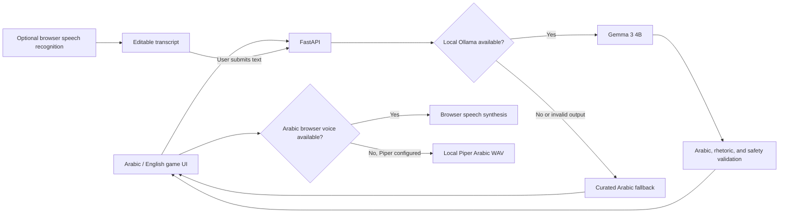

# Bayān Walk | بَيَان

**An Arabic-first rhetoric field game.** Choose a البلاغة challenge, step away from the screen to notice the world, then return to write an original Arabic image. Arabic is the default product language. The EN/عربي control switches the interface and translates generated missions and feedback in either direction using local Gemma.

The game loop is intentionally short on-screen: choose a challenge, pocket the phone, observe safely, and come back to reflect. Completing a round earns experience points stored in this browser.

## Why Open Models

Gemma 3 4B runs locally through Ollama for mission generation, Arabic writing feedback, chat, and bidirectional text translation. This makes model choice and prompts inspectable and avoids sending text to a hosted model API. When Gemma is unavailable or its answer fails Arabic, rhetoric, or safety checks, curated fallback content keeps the game usable.

Voice chat is available from the always-visible Talk to Bayān control. Type or use push-to-talk dictation, review the transcript, then send the text to local Gemma; recent turns stay in browser memory only. Browser speech recognition may use a browser-vendor network service; it is **not guaranteed to be local or private**, and may be unavailable in Firefox. Spoken replies use a matching browser voice when installed, or the optional local Piper route for Arabic. Bayān does not record or upload raw audio to its backend.

If the browser has no Arabic voice, optional local Piper speech can be enabled. Install its separately licensed engine and download a supported Arabic voice:

```bash
pip install -r requirements-voice.txt
mkdir -p .models
python -m piper.download_voices ar_JO-kareem-medium --data-dir .models
```

Set `PIPER_AR_VOICE` to the downloaded `.onnx` file path before starting FastAPI (for example, `.models/ar_JO-kareem-medium.onnx`). Piper itself is GPL-3.0; the Kareem model card points to its training dataset for licensing, so review that source and terms for your use before enabling/distributing it. The voice model is not bundled or committed. The API synthesizes Arabic WAV locally; no reply text is sent to a speech service.

## Local Setup

Requirements: Python 3.10+, [Ollama](https://ollama.com/), and a browser. Node.js is not required.

```bash
ollama pull gemma3:4b
python3 -m venv .venv
source .venv/bin/activate
pip install -r requirements.txt
```

Start Ollama in one terminal:

```bash
ollama serve
```

Start Bayān in another terminal from the repository root:

```bash
.venv/bin/uvicorn backend.main:app --reload
```

Open <http://127.0.0.1:8000>. To use another compatible local Ollama model, set `OLLAMA_MODEL` before starting the server. The default is `gemma3:4b`.

If Ollama is unavailable, Bayān uses curated Arabic mission and feedback cards. Voice input/output availability depends on browser support and installed speech services or voices.

## Test

```bash
.venv/bin/python -m unittest discover -s tests -v
```

The tests cover Arabic output validation, safe mission fallback, rhetoric-mode checks, and FastAPI routes.

## Architecture



## Safety and Scope

- Missions are designed for stationary or safe outdoor observation. Never use the game while crossing roads or in unsafe surroundings.
- Missions must not ask players to close their eyes, climb, touch, pick, consume, photograph, or record anything.
- Arabic feedback is a learning suggestion, not an authoritative linguistic grade.
- Browser speech recognition accuracy and privacy vary by browser, locale, microphone, and network. Review dictated text before submission; manual typing is always available.
- Bayān does not store accounts, precise location, reflections, audio, or photos. XP and round count are stored in browser local storage.

## Hacktoberfest Week 1

Bayān is a new project for the Hacktoberfest Open-Source AI Challenge: Week 1 — “Touch Grass.” The challenge runs October 5–11 PDT, with the final cutoff at 11:59 PM PDT on October 11 (October 12 at 7:59 AM WAT). Verify the live challenge page before submitting. The DEV entry must include the public repository, a real demo, and an honest account of any outdoor test.

## License

MIT. See [`LICENSE`](LICENSE).
