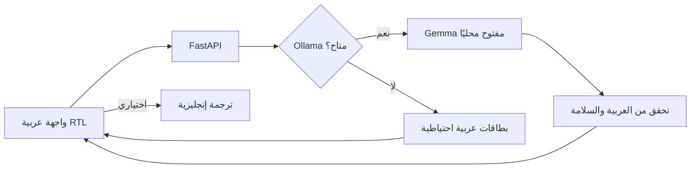

# بَيَان | Bayān Walk

لعبة بلاغية عربية تدعوك إلى الخروج، وتأمل مشهد حقيقي، ثم العودة لتصوغ ملاحظتك بالعربية. العربية هي لغة المنتج وتجربته الأساسية؛ الترجمة إلى الإنجليزية اختيارية فقط.

> جولة بلاغية قصيرة: اختر تمرينًا، أغلق الشاشة، تأمل العالم، ثم اكتب عبارتك.

## لماذا بَيَان؟

تطبيقات التعلم غالبًا تطلب مزيدًا من وقت الشاشة. بَيَان يقلب الترتيب: نموذج Gemma المفتوح يعمل محليًا عبر Ollama ليقترح تمرينًا عربيًا قصيرًا، ثم يفسح المجال للملاحظة الواقعية. بعد العودة، يعطي المتعلم تغذية راجعة عربية موجزة على محاولته البلاغية.

لا نطلب الموقع الدقيق أو الصور أو التسجيلات. لا توجد واجهة سحابية للذكاء الاصطناعي في مسار المنتج.

## التشغيل المحلي

المتطلبات: Python 3.10+، Node غير مطلوب، و[Ollama](https://ollama.com/) مع نموذج Gemma.

```bash
ollama pull gemma3:4b
python3 -m venv .venv
source .venv/bin/activate
pip install -r requirements.txt
ollama serve
```

في نافذة طرفية أخرى:

```bash
cd bayaan
uvicorn backend.main:app --reload
```

افتح http://127.0.0.1:8000 . لتبديل النموذج، عيّن `OLLAMA_MODEL` قبل تشغيل الخادم. الإعداد الافتراضي `gemma3:4b`.

إذا لم يكن Ollama متاحًا، يظل توليد المهمة والتغذية الراجعة يعملان ببطاقات عربية ثابتة. الترجمة لا تعمل دون النموذج المحلي.

## تحقق سريع

```bash
python3 -m unittest discover -s tests -v
```

## التصميم



## النطاق والحدود

- التدريب البلاغي للتأمل والكتابة، وليس تقييمًا أكاديميًا معتمدًا.
- تغذية Gemma الراجعة اقتراح تعليمي قابل للنقاش، وليست حكمًا لغويًا نهائيًا.
- البطاقات مصممة للتأمل في مكان آمن؛ لا تستخدم أثناء عبور الطريق أو في ظروف غير آمنة.
- أداة الترجمة الحالية تترجم إلى الإنجليزية فقط. يمكن توسيع قائمة اللغات لاحقًا دون تغيير كون العربية هي اللغة الأصلية للتجربة.

## تحدي Hacktoberfest

مُعدّ كتطبيق جديد لتحدي Hacktoberfest Open-Source AI Challenge: Week 1 — Touch Grass. يجب إضافة رابط المستودع العام، عرض توضيحي حقيقي، واختبار ميداني صادق قبل كتابة أي ادعاء بذلك في المشاركة.

## الترخيص

MIT. راجع ملف `LICENSE`.
