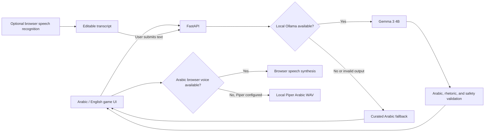

# Bayān Walk | بَيَان

**An Arabic-first rhetoric field game.** Choose a البلاغة challenge, step away from the screen to notice the world, then return to write an original Arabic image. Arabic is the default product language. The EN/عربي control switches the interface and translates generated missions and feedback in either direction using local Gemma.

The game loop is intentionally short on-screen: choose a challenge, pocket the phone, observe safely, and come back to reflect. Completing a round earns experience points stored in this browser.

## Why Open Models

Gemma 3 4B runs locally through Ollama for mission generation, Arabic writing feedback, chat, and bidirectional text translation. This makes model choice and prompts inspectable and avoids sending text to a hosted model API. When Gemma is unavailable or its answer fails Arabic, rhetoric, or safety checks, curated fallback content keeps the game usable.

Voice chat is available from the always-visible Talk to Bayān control. Arabic dictation uses the browser's live speech-recognition API when available, showing interim text while you speak; browser providers may process audio remotely. If live recognition is unavailable or fails, Bayān records the clip and transcribes it locally with faster-whisper after you stop. Review and correct the transcript before sending it to local Gemma. Arabic replies stay Arabic regardless of interface language and are spoken by local Piper when configured, or an installed browser voice. Transcription and model output are best-effort, not perfect.

Install optional local voice dependencies and download the Arabic voice:

```bash
pip install -r requirements-voice.txt
mkdir -p .models
python -m piper.download_voices ar_JO-kareem-medium --data-dir .models
```

Set `PIPER_AR_VOICE` to the downloaded `.onnx` file path before starting FastAPI (for example, `.models/ar_JO-kareem-medium.onnx`). Set `WHISPER_MODEL` to choose a faster-whisper model; the default is `small`, downloaded into the local model cache on first use. Piper itself is GPL-3.0; the Kareem model card points to its training dataset for licensing, so review that source and terms for your use before enabling/distributing it. Neither speech model is bundled or committed. Arabic speech is synthesized locally as WAV; reply text is not sent to a speech service.

## Local Setup

Requirements: Python 3.10+, [Ollama](https://ollama.com/), and a browser. Node.js is not required.

```bash
ollama pull gemma3:4b
python3 -m venv .venv
source .venv/bin/activate
pip install -r requirements.txt
```

Start Ollama in one terminal:

```bash
ollama serve
```

Start Bayān in another terminal from the repository root:

```bash
.venv/bin/uvicorn backend.main:app --reload
```

Open <http://127.0.0.1:8000>. To use another compatible local Ollama model, set `OLLAMA_MODEL` before starting the server. The default is `gemma3:4b`.

If Ollama is unavailable, Bayān uses curated Arabic mission and feedback cards. Voice input/output availability depends on browser support and installed speech services or voices.

## Test

```bash
.venv/bin/python -m unittest discover -s tests -v
```

The tests cover Arabic output validation, safe mission fallback, rhetoric-mode checks, and FastAPI routes.

## Architecture



## Safety and Scope

- Missions are designed for stationary or safe outdoor observation. Never use the game while crossing roads or in unsafe surroundings.
- Missions must not ask players to close their eyes, climb, touch, pick, consume, photograph, or record anything.
- Arabic feedback is a learning suggestion, not an authoritative linguistic grade.
- Live browser speech recognition is not available in every browser and may process audio through its provider. The local faster-whisper fallback is record-then-transcribe, not streaming. Accuracy varies by dialect, microphone, and environment; review dictated text before submission.
- Bayān does not store accounts, precise location, reflections, audio, or photos. XP and round count are stored in browser local storage.

## Hacktoberfest Week 1

Bayān is a new project for the Hacktoberfest Open-Source AI Challenge: Week 1 — “Touch Grass.” The challenge runs October 5–11 PDT, with the final cutoff at 11:59 PM PDT on October 11 (October 12 at 7:59 AM WAT). Verify the live challenge page before submitting. The DEV entry must include the public repository, a real demo, and an honest account of any outdoor test.

## License

MIT. See [`LICENSE`](LICENSE).
